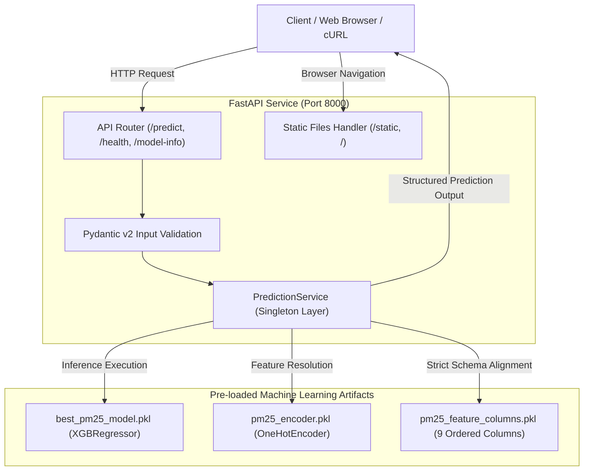

# 💨 AeroPredict: Air Pollution PM2.5 Prediction System
# نظام التنبؤ بتلوث الهواء والجسيمات الدقيقة PM2.5

[](https://www.python.org/)
[](https://fastapi.tiangolo.com/)
[](https://xgboost.readthedocs.io/)
[](https://www.docker.com/)
[-success.svg?logo=pytest&logoColor=white)](https://pytest.org/)
[](#)
[](#)

---

## 📌 Table of Contents / جدول المحتويات

- [English Overview](#-english-overview)
- [نظرة عامة بالعربية](#-نظرة-عامة-بالعربية)
- [System Architecture](#-system-architecture)
- [Dataset & Model Specifications](#-dataset--model-specifications)
- [Input Features Schema](#-input-features-schema-9-features)
- [REST API Reference & Endpoints](#-rest-api-reference--endpoints)
- [Web Interface Features](#-web-interface-features)
- [Docker Deployment Guide](#-docker-deployment-guide)
- [Local Installation & Setup](#-local-installation--setup)
- [Automated Testing](#-automated-testing)
- [Project Directory Structure](#-project-directory-structure)

---

## 🌐 English Overview

**AeroPredict** is a production-grade machine learning application designed to forecast fine particulate matter (**PM2.5** concentration in $\mu g/m^3$) based on atmospheric conditions, barometric pressure, dew point, temperature, and temporal indicators across Beijing monitoring stations.

The system utilizes an **Extreme Gradient Boosting (XGBoost)** regressor trained and evaluated on **75,896** verified records from the combined Beijing air quality monitoring stations (**US Embassy** and **Aotizhongxin**). It couples an asynchronous **FastAPI** backend with a modern, responsive, bilingual (English & Arabic) web application and turnkey **Docker** containerization.

### Core Highlights
* **Optimized 9-Feature Pipeline**: Streamlined inference engine requiring only 7 meteorological/temporal features plus 2 station indicators.
* **Dual Station Encoding**: Accepts direct one-hot features (`station_Aotizhongxin`, `station_US_Embassy`) or station names (`"US_Embassy"`, `"Aotizhongxin"`).
* **High-Performance FastAPI Backend**: In-memory artifact caching via lifespan events, zero redundant file reads, and sub-5ms model inference.
* **Zero-Dependency Native Frontend**: Pure HTML5 Canvas charts, dynamic light/dark theming, and 100% Arabic (RTL) / English (LTR) transitions without heavy external frameworks.
* **Containerized Deployment**: Multi-stage Docker container with OpenMP runtime (`libgomp1`) listening on port `8000`.

---

## 🌍 نظرة عامة بالعربية

**إيرو بريديكت (AeroPredict)** هو نظام متكامل ومحترف لتعلم الآلة مبني للتنبؤ بتركيز الجسيمات الدقيقة العالقة في الهواء (**PM2.5** بالميكروغرام/متر مكعب $\mu g/m^3$) بدقة عالية، بالاعتماد على المؤشرات الجوية، الضغط الجوي، درجة الحرارة، نقطة الندى، والعوامل الزمنية عبر محطات الرصد في مدينة بكين.

يعتمد النظام على خوارزمية **XGBoost Regressor** مدربة ومختبرة على **75,896** رصداً جوياً موثقاً من مجموعة بيانات بكين المدمجة لمحطتي الرصد: **محطة السفارة الأمريكية (US Embassy)** و**محطة أوتيتشونغشين (Aotizhongxin)**. يوفر النظام واجهة برمجية فائقة السرعة بواسطة **FastAPI** مدمجة مع واجهة ويب تفاعلية متجاوبة تدعم اللغتين العربية والإنجليزية والمظهرين الداكن والفاتح، بالإضافة إلى دعم كامل للحاويات عبر **Docker**.

### أبرز الخصائص والمميزات:
1. **خط استدلال محسّن بـ 9 مدخلات**: التنبؤ بالاعتماد على 7 متغيرات جوية وزمنية بالإضافة إلى محطة الرصد.
2. **مرونة كاملة في الترميز**: إمكانية إدخال مؤشرات المحطة المباشرة كقيم رقمية (0 و 1) أو إرسال اسم المحطة الصريح بالاسم.
3. **أداء استدلالي فائق السرعة**: تحميل النموذج والمشفر لمرة واحدة في الذاكرة مع زمن استجابة واستدلال يقل عن 5 مللي ثانية.
4. **واجهة تفاعلية خفيفة وثنائية اللغة**: دعم حقيقي للغة العربية والاتجاه من اليمين لليسار (RTL)، وتبديل فوري للمظهر (Dark/Light).
5. **جاهز للنشر بالحاويات (Docker)**: بيئة معزولة جاهزة للتشغيل بأمر واحد على المنفذ `8000`.

---

## 🏛 System Architecture



---

## 📊 Dataset & Model Specifications

### Dataset Overview
* **Source**: Beijing Combined Air Quality & Meteorological Records.
* **Stations**:
  * **US Embassy Station**: 41,757 observed PM2.5 records (Historical baseline).
  * **Aotizhongxin Station**: 34,139 observed PM2.5 records (Multi-site monitoring).
* **Total Supervised Observations**: `75,896` clean rows.
* **Target Variable**: Fine particulate matter `PM2.5` ($\mu g/m^3$).

### Model Evaluation (20% Holdout Chronological Test Set - 15,180 Samples)
| Metric | Value | Interpretation |
| :--- | :--- | :--- |
| **MAE (Mean Absolute Error)** | **42.95 µg/m³** | Average prediction deviation from ground truth |
| **RMSE (Root Mean Squared Error)** | **61.62 µg/m³** | Standard deviation of prediction residuals |
| **$R^2$ Score** | **0.5348** | Explains >53% of variance across seasonal extremes |
| **Inference Latency** | **~2.8 ms** | Real-time production grade throughput |

### Feature Importance Distribution
```
DEWP (Dew Point)        [████████████████████] 22.29%
TEMP (Temperature)      [████████████████]     18.56%
month (Month of Year)   [███████████████]      17.77%
station_Aotizhongxin    [█████████]            10.00%
station_US_Embassy      [███████]               7.75%
day (Day of Month)      [██████]                7.11%
PRES (Pressure)         [██████]                6.87%
year (Observation Year) [█████]                 6.17%
hour (Hour of Day)      [███]                   3.48%
```

---

## 📋 Input Features Schema (9 Features)

The trained model strictly operates on the following 9 ordered columns:

| Feature Name | Type | Range / Options | Unit | Description |
| :--- | :--- | :--- | :--- | :--- |
| `year` | integer | $2000 \dots 2100$ | Year | Observation year (e.g. `2014`) |
| `month` | integer | $1 \dots 12$ | Month | Month of the year |
| `day` | integer | $1 \dots 31$ | Day | Day of the month |
| `hour` | integer | $0 \dots 23$ | Hour | Hour of day in 24-hour format |
| `DEWP` | float | $-60.0 \dots 50.0$ | °C | Atmospheric Dew Point temperature |
| `TEMP` | float | $-50.0 \dots 60.0$ | °C | Ambient surface air temperature |
| `PRES` | float | $900.0 \dots 1100.0$ | hPa | Barometric pressure at station |
| `station_Aotizhongxin` | float | `0.0` or `1.0` | Binary | 1 if station is Aotizhongxin, else 0 |
| `station_US_Embassy` | float | `0.0` or `1.0` | Binary | 1 if station is US Embassy, else 0 |

> **💡 Developer Convenience**: You can also simply provide `"station": "US_Embassy"` or `"station": "Aotizhongxin"` in your JSON payload, and the API will automatically encode `station_Aotizhongxin` and `station_US_Embassy`.

---

## 🔌 REST API Reference & Endpoints

### Base URL: `http://localhost:8000`

### 1. Make Prediction
* **Endpoint:** `POST /predict` (also available under `/api/predict`)
* **Headers:** `Content-Type: application/json`

#### Option A: Direct One-Hot Encoded Station Features
```json
{
  "year": 2014,
  "month": 6,
  "day": 15,
  "hour": 12,
  "DEWP": 10.0,
  "TEMP": 25.0,
  "PRES": 1005.0,
  "station_Aotizhongxin": 0.0,
  "station_US_Embassy": 1.0
}
```

#### Option B: Friendly Station Name String
```json
{
  "year": 2014,
  "month": 10,
  "day": 20,
  "hour": 20,
  "DEWP": 14.2,
  "TEMP": 16.9,
  "PRES": 1016.4,
  "station": "Aotizhongxin"
}
```

#### Successful Response (`200 OK`):
```json
{
  "status": "success",
  "target_name": "PM2.5 Concentration",
  "unit": "µg/m³",
  "predicted_pm25": 50.96,
  "input_features": {
    "year": 2014,
    "month": 6,
    "day": 15,
    "hour": 12,
    "DEWP": 10.0,
    "TEMP": 25.0,
    "PRES": 1005.0,
    "station_Aotizhongxin": 0.0,
    "station_US_Embassy": 1.0,
    "station": "US_Embassy"
  },
  "model_name": "XGBoost Regressor (best_pm25_model.pkl)",
  "timestamp": "2026-11-01T13:08:57.153217+00:00",
  "execution_time_ms": 2.84
}
```

---

### 2. Service Health & Readiness
* **Endpoint:** `GET /health`
* **Response (`200 OK`):**
```json
{
  "status": "healthy",
  "model_loaded": true,
  "encoder_loaded": true,
  "features_loaded": true,
  "service_ready": true,
  "target_name": "PM2.5 Concentration",
  "target_unit": "µg/m³",
  "expected_features": [
    "year", "month", "day", "hour",
    "DEWP", "TEMP", "PRES",
    "station_Aotizhongxin", "station_US_Embassy"
  ],
  "details": "All ML artifacts loaded and active."
}
```

---

### 3. Model Metadata & Verified Metrics
* **Endpoint:** `GET /model-info`
* **Response (`200 OK`):**
```json
{
  "model_type": "XGBRegressor (Extreme Gradient Boosting Regressor)",
  "target_variable": "PM2.5 (PM2.5 Concentration)",
  "target_unit": "µg/m³",
  "feature_columns": [
    "year", "month", "day", "hour",
    "DEWP", "TEMP", "PRES",
    "station_Aotizhongxin", "station_US_Embassy"
  ],
  "categorical_categories": {
    "station": ["Aotizhongxin", "US_Embassy"]
  },
  "feature_importance": {
    "DEWP": 0.2229,
    "TEMP": 0.1856,
    "month": 0.1777,
    "station_Aotizhongxin": 0.1,
    "station_US_Embassy": 0.0775,
    "day": 0.0711,
    "PRES": 0.0687,
    "year": 0.0617,
    "hour": 0.0348
  },
  "evaluation_metrics": {
    "mae": 42.95,
    "rmse": 61.62,
    "r2_score": 0.5348,
    "test_samples_count": 15180,
    "train_split_ratio": 0.8
  }
}
```

---

### 4. Other Available Endpoints
* `GET /`: Interactive web client frontend.
* `GET /historical-stats`: Monthly/hourly averages and record counts across stations.
* `GET /sample-records`: Pre-configured authentic scenarios for testing.
* `GET /docs`: Swagger OpenAPI interactive documentation.
* `GET /redoc`: ReDoc technical API documentation.

---

## 💻 Web Interface Features

The application bundles an interactive frontend served directly from the root path `/`:

1. **Environmental Color Scheme**: Clean teal and sky-blue palette tailored for atmospheric analytics.
2. **Instant Language Switching**: Full support for Arabic (`dir="rtl"`) and English (`dir="ltr"`) with local storage persistence.
3. **Dark / Light Theme Toggle**: Seamless transition between high-contrast dark theme and crisp light theme.
4. **Historical Presets**: One-click scenario loading:
   * **Clean Air**: Spring day at US Embassy (`11.0 µg/m³`).
   * **Moderate Air**: Summer morning at US Embassy (`55.0 µg/m³`).
   * **Severe Pollution**: Autumn inversion at Aotizhongxin station (`243.0 µg/m³`).
5. **Interactive Charts**: Rendered using native HTML5 Canvas without bulky charting libraries:
   * **Monthly PM2.5 Cycle**: Seasonal pollution oscillation.
   * **24-Hour Diurnal Curve**: Night-time vs daytime variations.
   * **Feature Importance Chart**: Relative impact of each model input.

---

## 🐳 Docker Deployment Guide

The project includes an optimized `Dockerfile` based on `python:3.12-slim` with OpenMP runtime dependencies for XGBoost.

### Step 1: Build the Docker Image
```bash
docker build -t pm25-api .
```

### Step 2: Run the Docker Container
```bash
docker run -d -p 8000:8000 --name pm25-app pm25-api
```

### Step 3: Verify the Running Service
Open your web browser or terminal:
* **Web UI Dashboard**: [http://localhost:8000/](http://localhost:8000/)
* **Interactive Swagger Docs**: [http://localhost:8000/docs](http://localhost:8000/docs)
* **Health Check Endpoint**: [http://localhost:8000/health](http://localhost:8000/health)

### Step 4: Container Management
```bash
# View container logs
docker logs -f pm25-app

# Stop the container
docker stop pm25-app

# Remove the container
docker rm pm25-app
```

---

## 🛠 Local Installation & Setup

If you prefer to run the project locally without Docker:

### Prerequisites
* Python 3.10, 3.11, or 3.12 installed.

### 1. Clone or Open Workspace
```bash
cd "pm25-api1"
```

### 2. Create and Activate a Virtual Environment
```bash
# Windows
python -m venv venv
venv\Scripts\activate

# Linux / macOS
python3 -m venv venv
source venv/bin/activate
```

### 3. Install Dependencies
```bash
pip install --upgrade pip
pip install -r requirements.txt
```

### 4. Run the Server
```bash
python run.py
```
Or run directly with Uvicorn:
```bash
uvicorn app:app --host 0.0.0.0 --port 8000
```

---

## 🧪 Automated Testing

The project maintains a dedicated test suite verifying API integrity, schema constraints, direct one-hot features, station name inference, and model outputs.

Run all tests with:
```bash
python -m pytest tests/ -v
```

### Test Coverage Highlights:
* `test_health_endpoint`: Ensures all 3 artifacts load and verifies the 9 feature columns.
* `test_predict_endpoint_valid_sample_with_station_name`: Tests inference using `"station": "US_Embassy"`.
* `test_predict_endpoint_direct_onehot_station`: Tests inference using direct `station_Aotizhongxin` and `station_US_Embassy` indicators.
* `test_predict_endpoint_aotizhongxin_name`: Tests inference for the Aotizhongxin station.
* `test_predict_validation_invalid_month`: Tests 422 HTTP validation on out-of-range months.
* `test_predict_validation_invalid_station`: Tests 422 HTTP validation on unknown stations.
* `test_predict_validation_missing_field`: Tests 422 HTTP validation on incomplete payloads.
* `test_model_info_endpoint`: Validates architectural metadata and verified test metrics.
* `test_historical_stats_endpoint`: Verifies combined dataset record count (75,896 observations).

---

## 📁 Project Directory Structure

```
pm25-api1/
│
├── best_pm25_model.pkl              # Production XGBoost regressor (9 input features)
├── pm25_encoder.pkl                 # OneHotEncoder for station categories
├── pm25_feature_columns.pkl         # 9 ordered feature names for inference
│
├── Beijing_PM25_Combined_Master_78888.csv    # Combined multi-station master dataset
├── Beijing_PM25_Training_Ready_75896.csv     # Filtered clean training dataset
├── Beijing_PM25_Combined_Audit.txt           # Data quality and provenance audit report
│
├── app.py                           # FastAPI application entrypoint & lifespan manager
├── run.py                           # One-command local startup script
├── Dockerfile                       # Production container definition (Python 3.12 + OpenMP)
├── .dockerignore                    # Build optimization rules
├── requirements.txt                 # Pinned dependencies
├── README.md                        # Complete project documentation
│
├── api/                             # Backend API Package
│   ├── __init__.py
│   ├── config.py                    # Paths and environment settings
│   ├── schemas.py                   # Pydantic v2 validation models
│   ├── service.py                   # Singleton inference & preprocessing service
│   └── routes.py                    # REST API endpoints definition
│
├── static/                          # Interactive Frontend Application
│   ├── index.html                   # Bilingual dashboard HTML
│   ├── css/
│   │   └── style.css                # Adaptive theme tokens, responsive grid & RTL rules
│   └── js/
│       ├── i18n.js                  # English/Arabic translation dictionary & engine
│       ├── theme.js                 # Dark/Light theme manager
│       ├── api.js                   # Client HTTP fetch layer
│       ├── charts.js                # Canvas analytics charts
│       └── app.js                   # UI event bindings & validation controller
│
├── tests/                           # Quality Assurance Suite
│   ├── __init__.py
│   └── test_api.py                  # Pytest integration & schema test suite
│
└── mlflow_artifacts/                # Experiment tracking logs & validation plots
    ├── model_report.txt             # Verified test set evaluation report
    ├── feature_importance.csv       # Relative feature contribution weights
    ├── feature_importance.png       # Importance visualization plot
    ├── actual_vs_predicted.png      # Residual parity plot
    └── residual_distribution.png    # Residual error distribution
```

---

## 📄 License & Attribution

* **Dataset**: Beijing Municipal Environmental Monitoring Center / US Department of State Air Quality Monitoring Program.
* **Architecture & Backend**: Powered by [FastAPI](https://fastapi.tiangolo.com/) and [XGBoost](https://xgboost.readthedocs.io/).

